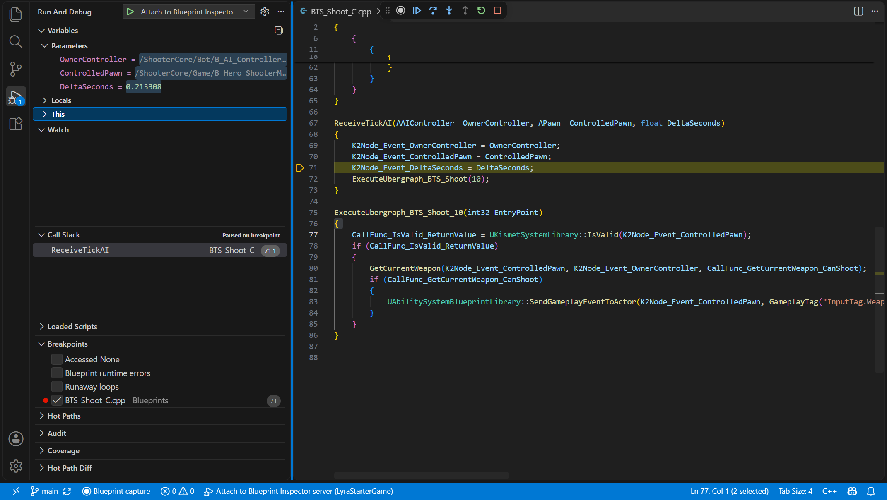
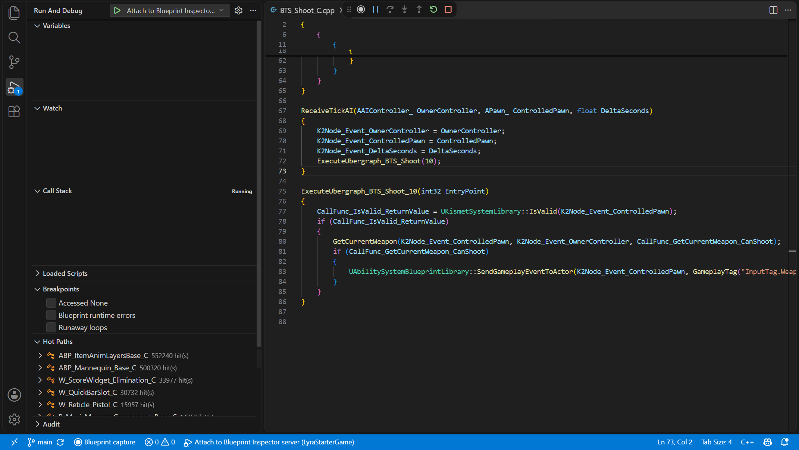
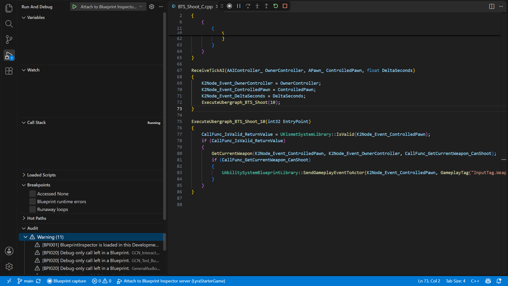

# BlueprintInspector

BlueprintInspector is a debugger for Unreal Blueprints. It turns compiled Blueprint bytecode into
C-like source and serves it over DAP, so you can set breakpoints and step through Blueprints in
VS Code. It works in PIE, standalone and packaged builds.

Tested on UE 4.25 through 5.8. Win64 only. The current beta is 2.0.3.



`BTS_Shoot_C` stopped in `ReceiveTickAI`. The parameters and call stack are live, and the editor shows
the compiled statements.

## The compiled view

The graph editor shows the nodes you placed. The pseudo-source shows what the compiler produced:
named temporaries, explicit `if`, `switch`, `while` and `goto`, and the calls the VM makes. You can
break on those statements, step into a Blueprint call used as an operand, and read values at that
point. The source is a view, not an editable asset.

## Getting started

1. Download the plugin zip from
   [Releases](https://github.com/HexTank/BlueprintInspector/releases) and put the `BlueprintInspector`
   folder in `<Project>/Plugins/BlueprintInspector`. Keep the folder name.
2. Open the project. The editor builds the module on first launch.
3. Install the [VS Code extension](https://marketplace.visualstudio.com/items?itemName=HexTank.blueprint-inspector).
   For another DAP client, use `127.0.0.1:19021`.
4. Run **Blueprint Inspector: Start Game and Attach** from the command palette. If a game is already
   listening on 19021, it attaches to that. Otherwise set `blueprintInspector.gameExecutable` to your
   packaged build and the command starts it.

The session opens a Blueprint picker. Pick a class, click the gutter to set a breakpoint, and play. A
stop freezes the game thread. Continue to resume.

If you would rather start from a launch configuration:

```json
{
  "type": "blueprint-inspector",
  "request": "launch",
  "name": "Attach to Blueprint Inspector server",
  "debugServer": 19021
}
```

## Once you're attached

Breakpoints land on statements, sequence pins and `goto`. Conditions, hit counts and logpoints with
`{expr}` placeholders use the normal VS Code UI. Step over, step in and step out follow the compiled
flow.

At a stop you get locals, parameters and `this`, including structs and containers. `setVariable`
writes back to them. Interface properties, delegates and whole-container text edits cannot be written.

The exception filters stop on Accessed None, Blueprint runtime errors and runaway loops. They are off
by default. A stop shows the VM's message. Continue resumes after the error, and the error still
reaches the log. Worker-thread errors are logged, not stopped.

Every command and view is in the [extension README](VSCodeExtension/Extension/README.md).

## Watching a run

Hot Paths counts executed statements and break/continue arms. Start a capture and play, and the view
ranks classes, functions and lines by hits. Lines get an orange heat background and a hit count.
Selecting one opens it. It's counts, not timings, so it won't tell you what is slow. It will tell you
whether a Tick graph runs and which branch the AI took.



Hot Paths after a capture in Lyra. The status bar reports 1,210,853 hits on rendered lines.

Coverage uses the same counters. It lists classes, functions and lines with covered/total counts,
least-covered first. It can hide everything that ran so you only see the gaps. Export to JSON or LCOV.
Capture snapshots save a run and diff the next one against it. The diff puts regressions first.

## Auditing before a release

The audit checks loaded Blueprints for common Shipping mistakes: credentials in defaults, leftover
`PrintString` calls, console commands, expensive Tick work, casts with no null check, and duplicate
class names. Values that look like secrets are redacted before they reach the report. It can hitch on
a large project.



The Audit view in Lyra shows 0 errors, 11 warnings and 4 info findings across 120 classes. `BPI001` is
expected when the plugin is loaded.

| Rule | Severity | What it flags |
|---|---|---|
| `BPI001` | error in Shipping, warning otherwise | The plugin is loaded in this build, so the DAP listener is present. One project-level finding. |
| `BPI010` | error | A string literal or class default that looks like a credential. Evidence is redacted. |
| `BPI020` | warning | `PrintString`, `PrintText`, `DrawDebug*` or `Breakpoint` left in a Blueprint. |
| `BPI021` | error | `ExecuteConsoleCommand`, `QuitGame`, `SetGamePaused`, `OpenLevel` or `LoadStreamLevel`. |
| `BPI030` | warning, info in an ubergraph | An expensive call in Event Tick, or in the event ubergraph of a class that implements Tick. |
| `BPI031` | info | A dynamic cast whose result no later condition tests. One finding per cast. |
| `BPI040` | warning | One class short name used by several packages. |
| `BPI041` | warning | The audit skipped part of the input because a function could not be disassembled, or because a class default nested too deeply. One summary finding. |

## Packaged builds

PIE, standalone and packaged builds all expose the listener. A packaged Shipping build starts its
default map and ignores a map URL, so the Blueprint picker lists the Blueprints reachable from that
map. Breakpoints, stepping and variable writes need a function that runs after you attach.

## Things that will trip you up

- Breakpoints land on statements. Inline operands such as `A + B` are not stop points. Step-in still
  enters a Blueprint call used as an operand.
- `K2Node_Select` compiles to one `EX_SwitchValue` with inline cases, so there are no `case` lines to
  break on. `K2Node_Switch*` is fine.
- `setVariable` cannot write interface properties, delegates or whole-container text edits.
- A stop parks the game thread. Continue or detach to resume.
- One client per session. A disconnect resumes the game and frees the slot.
- The listener is loopback-only and requires a token. The token is a session boundary, not a secret
  from another process running as the same user.

If attaching fails, check the token first. The plugin writes a new token for each connection. The
extension reads that copy before it asks for sources. If it still fails, restart the game. If the
token is not where the extension expects it, set `blueprintInspector.tokenFile`.

A few other things that come up:

- A breakpoint that resolves but never hits usually means the function does not run. It can also
  happen when the log reports `UWorld detour attach failed`.
- An empty Blueprint picker means the current map loaded no Blueprints.
- If port 19021 is already in use, another game or editor has it.

## How the connection works

Each connection gets a fresh token, normally at `<Project>/Saved/BlueprintInspector/dap-token`. The
plugin waits for that token before it serves source or breakpoints. Five bad attempts or five seconds
without a token closes the socket.

The extension checks, in order:

1. `blueprintInspector.tokenFile`
2. `%LOCALAPPDATA%\BlueprintInspector\dap-token`
3. `<workspace>/Saved/BlueprintInspector/dap-token`, plus one level down for the staged
   `<Package>/Windows/<Project>/Saved` layout
4. the folder it finds by walking up to a `.uproject`

If more than one token file exists, the newest one wins, so a token from another project is not picked
up. For a packaged game, open the directory that contains `Saved` as the workspace. `"trace": true`
logs every DAP message.

## Building it

```bat
:: build the module through a host project
Build.bat -Build Plugin -Project=<Project>\<Project>.uproject

:: run the suite
Scripts\Run-AutomationSuite.ps1 -Engine 5.8 -Project=<Project>\<Project>.uproject
```

More detail, including the multi-engine host and how to add an audit rule, is in CONTRIBUTING.md.

## Security

The listener is loopback-only, and every connection needs the token. The threat model covers another
host, another user, a stale token, a `setVariable` that escapes into memory it should not write, and a
DAP request that hangs, crashes or resumes the VM without authenticating. A compromised machine, a
patched game binary and admin rights are out of scope.

The token in the project's `Saved` directory uses that directory's permissions. Another local account
that can read that directory can read the token. The copy under `%LOCALAPPDATA%` is protected by your
user account's permissions. A client that has the token can make the plugin do a lot of work, because
the limits apply per response, not per session.

## Credits

BlueprintInspector is designed and maintained by Paul Tankard, 2024 to 2026. The main C++ code and
architecture are mine.

[DeepSeek Flash](https://www.deepseek.com/) was used heavily to get the beta across the line. It
helped author the test suite, worked alongside
[Open Code Review](https://github.com/alibaba/open-code-review) to find bugs, and wrote most of the
VS Code extension. My TypeScript is not strong, so the extension leaned on it.

## License

MIT. The bundled cppdap (Apache-2.0) and Detours (MIT) libraries are listed in
[THIRD-PARTY-NOTICES.md](THIRD-PARTY-NOTICES.md).
